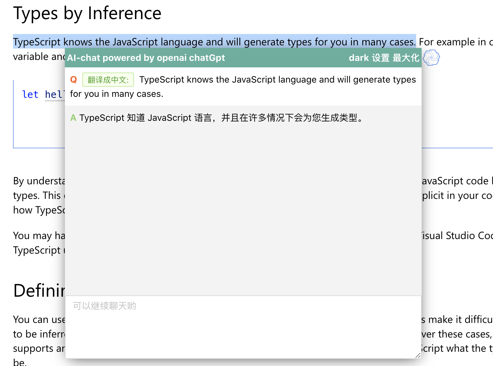
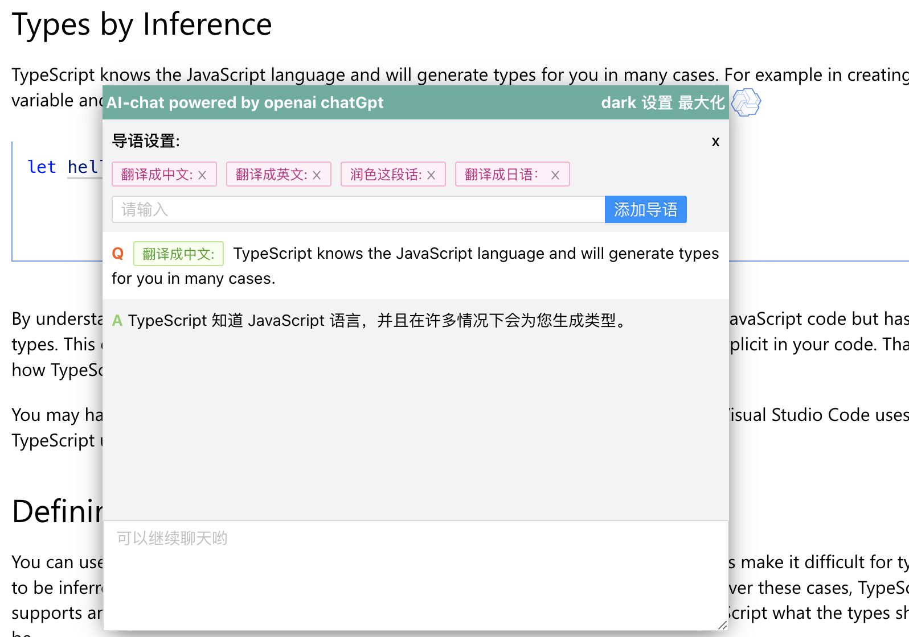
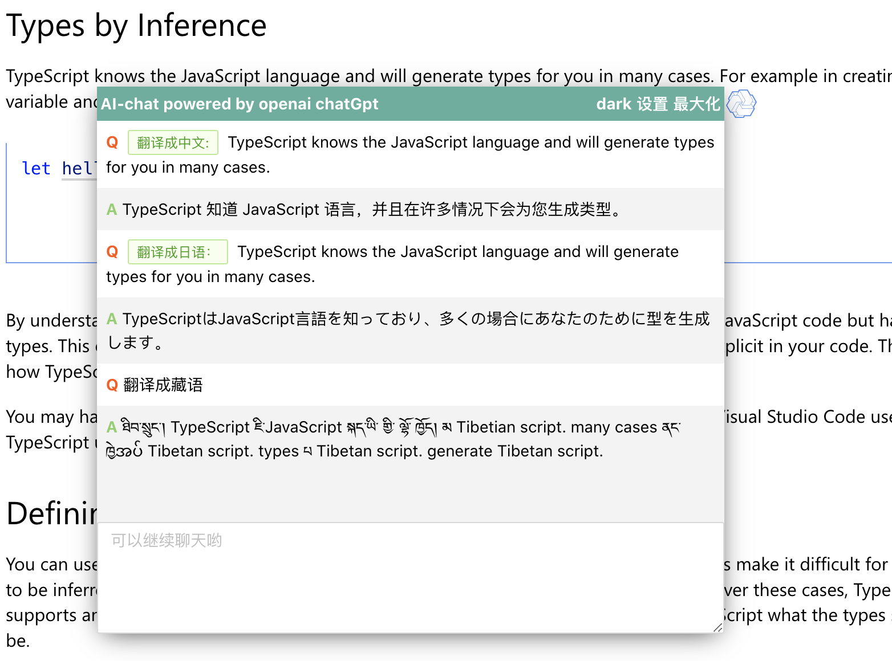
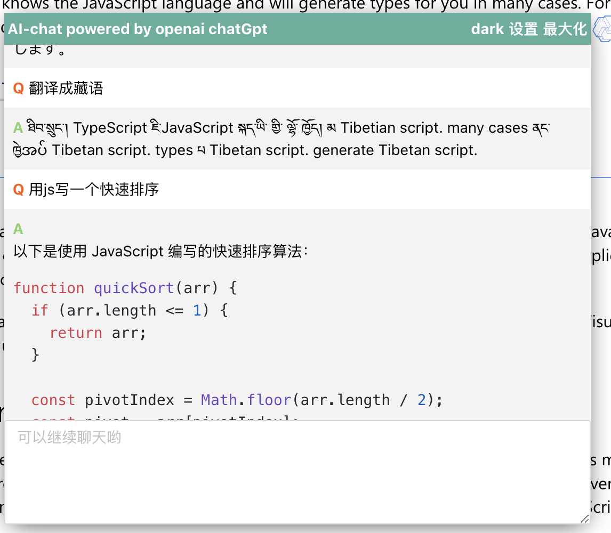
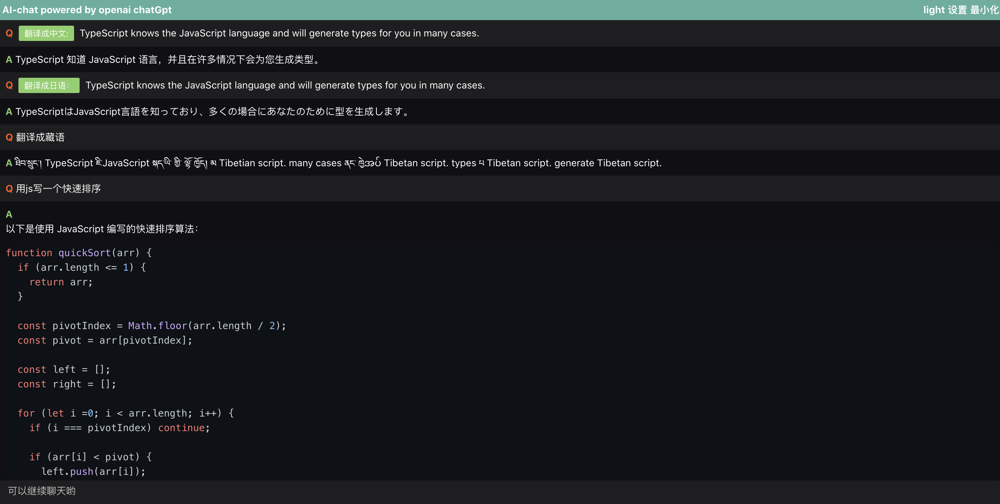
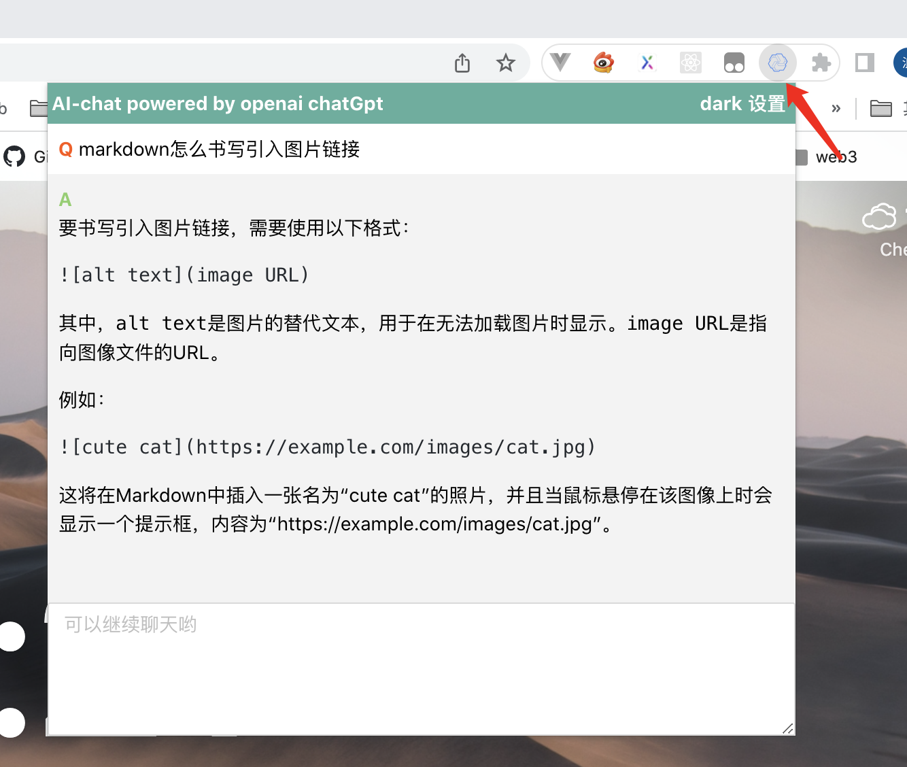

## AI-chat

Chrome Extension (Manifest V3) 划词聊天/翻译插件，支持 OpenAI、Anthropic、Google Gemini、DeepSeek、智谱 GLM、Kimi、阿里云 DashScope、SiliconFlow、Groq 等主流大模型。只需选择提供商、输入 API Key，即可使用。

使用 SSE 流式请求，支持 Markdown 渲染和代码语法高亮。

### 安装方式:

下载项目后，Chrome 地址栏输入 `chrome://extensions/`，打开开发者模式，选择「加载已解压的扩展程序」并选择项目的 `dist` 目录。

```bash
pnpm install
pnpm build    # 构建 content script + popup
pnpm typecheck
```

### 支持的模型提供商

| 提供商 | 模型 |
|--------|------|
| OpenAI | GPT-4.1, GPT-5, o3, o4-mini, GPT-4o |
| Anthropic | Claude Sonnet 4, Claude Opus 4 |
| Google Gemini | Gemini 2.5 Pro, Gemini 2.5 Flash |
| DeepSeek | DeepSeek V3, DeepSeek R1 |
| 智谱 GLM | GLM-4 Plus, GLM-4 Flash |
| 月之暗面 Kimi | Kimi 8K/32K/128K |
| 阿里云 DashScope | Qwen3 Max, Qwen Plus, Qwen Turbo |
| 硅基流动 SiliconFlow | Qwen3, DeepSeek V3/R1, GLM |
| Groq | Llama 3.3 70B, Mixtral 8x7B |

### 功能:

#### 1. 划词翻译



#### 2. 预设引导语



#### 3. 继续聊天



#### 4. Markdown 渲染和代码语法高亮



#### 5. 暗夜模式及全屏模式



#### 6. 点击右上角插件图标快速聊天


